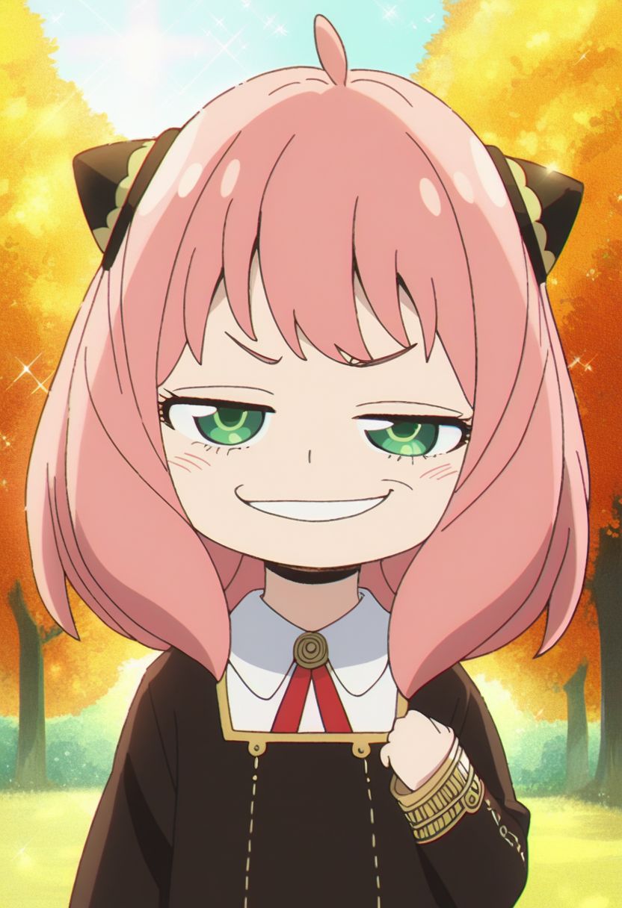

# Anya smug "heh" – Pony

Workflow: `anya_smug_pony.json` (drag into ComfyUI). Base: **Pony**. Keep prompts wholesome and SFW.

## Files needed

| File | What | Download | Put it in |
|---|---|---|---|
| `ponyDiffusionV6XL_v6StartWithThisOne.safetensors` | Checkpoint (Pony Diffusion V6 XL, includes CLIP + VAE) by **PurpleSmartAI** | https://civitai.com/models/257749?modelVersionId=290640 | `ComfyUI/models/checkpoints/pony/` |
| `Anya_Forger_-_Spy_X_Family.safetensors` | LoRA: Anya Forger (Pony V1) by **ethensia** | https://civitai.com/models/919274?modelVersionId=1028945 | `ComfyUI/models/loras/spyxfamily/` |

The workflow expects the subfolders shown above (for example `anima\...` or `pony\...`). If you put files elsewhere, re-pick them in the loader nodes.

## Trigger words

`anya forger, ahoge, meme`; outfits: `eden academy school uniform, gold trim, red ribbon` / `black dress` / `blue winter coat`

## Settings

- Sampler euler_ancestral, scheduler normal, 25 steps, CFG 7, 832x1216
- LoRA weights: Anya 0.9
- Seed: random

## Credits

- **PurpleSmartAI**: https://civitai.com/models/257749?modelVersionId=290640
- **ethensia**: https://civitai.com/models/919274?modelVersionId=1028945

Questions or issues? Ask me on X: https://x.com/Antilitist
