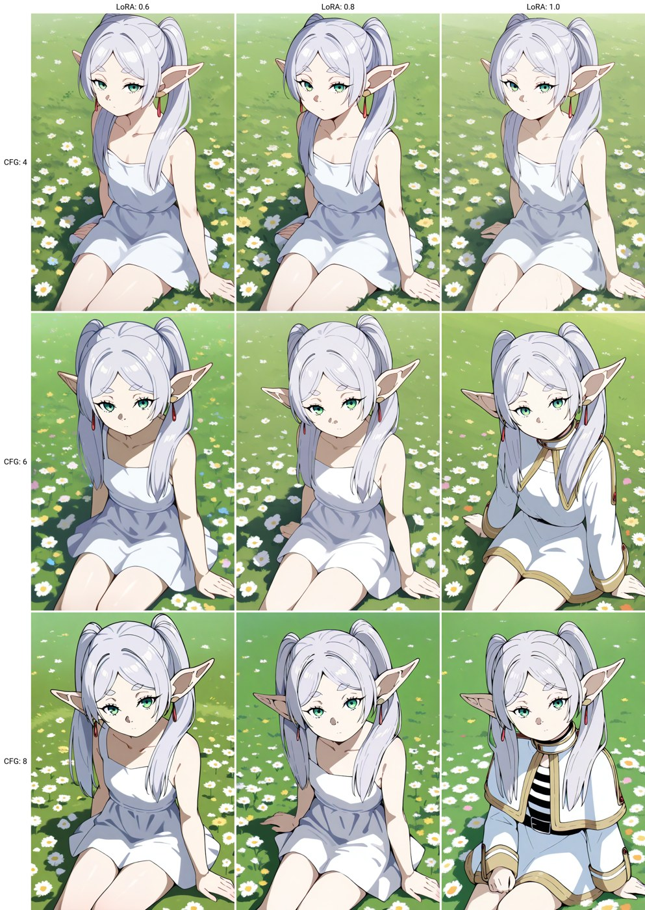

# D2 XY Plot: LoRA strength x CFG test (Frieren) - Illustrious

Workflow: `d2_xyplot_lora_cfg_test.json` (drag into ComfyUI). Base: **Illustrious-XL v2.0**.

It makes a 3x3 comparison grid with **D2 Nodes**. Across (X) is the Frieren LoRA strength, 0.6 / 0.8 / 1.0. Down (Y) is CFG, 4 / 6 / 8. Every cell uses the same seed, so the only changes are the LoRA strength and CFG. Quality tags are added for you, based on the checkpoint name. Prompts are wholesome and SFW.

## Custom nodes needed

- **D2 Nodes** by da2el: https://github.com/da2el-ai/D2-nodes-ComfyUI. Install it with ComfyUI-Manager (search "D2-nodes") or `git clone` it into `ComfyUI/custom_nodes/`, then run `pip install -r requirements.txt` with ComfyUI's Python. Version 32 and later need a recent ComfyUI (V3 nodes). This was tested with D2 Nodes v40.0.1 on ComfyUI 0.41.1.
- Everything else here is a core ComfyUI node (LoraLoader, String Multiline, Save Image).

## Files needed

| File | What | Download | Put it in |
|---|---|---|---|
| `Illustrious-XL-v2.0.safetensors` | Checkpoint (Illustrious-XL v2.0) by **OnomaAI Research** | https://huggingface.co/OnomaAIResearch/Illustrious-XL-v2.0/resolve/main/Illustrious-XL-v2.0.safetensors | `ComfyUI/models/checkpoints/illustrious/` |
| `frieren_littlejelly_ILL.safetensors` | LoRA: Frieren [4 outfits] Illustrious v1.0 by **LittleJelly** (it downloads as `SousouNoFrieren_Frieren_IlluXL.safetensors`; rename it) | https://civitai.com/models/1187259?modelVersionId=1336431 | `ComfyUI/models/loras/frieren/` |

If your files are somewhere else, pick them again in the loader nodes.

## How to use

1. Press **Queue** once. The **D2 XY Plot** node queues the other 8 runs by itself (`auto_queue` = true). The grid is saved to `output/d2_xyplot/` and each single image goes to `output/d2_xyplot/cells/`.
2. If a run stops partway, click **Set start index** on the D2 XY Plot node, then queue again.

## Changing the axes

- **Values:** edit `x_list` / `y_list` on the D2 XY Plot node, one value per line. Change `x_title` / `y_title` to rename the grid labels.
- **What X controls:** X is wired to the LoraLoader `strength_model` and `strength_clip`. Drag the `X` output onto another input to compare something else, for example D2 KSampler `steps` (set `x_type` to INT) or `seed`.
- **What Y controls:** Y is wired to D2 KSampler `cfg`. Rewire it the same way.
- **Text prompts:** set the type to STRING, then wire X/Y into a text node (or use **D2 XY Prompt SR / SR2** for search-and-replace).
- **Grid size:** any number of values works. Total runs = number of X values x number of Y values.

## Auto quality tags

The two **D2 Regex Switcher** nodes read the checkpoint name and pick the matching quality tags. Illustrious and NoobAI get `masterpiece, best quality, ...`, Pony gets `score_9, ...`, and anything else gets a generic fallback. The tags go in front of your positive and negative prompts. To add another model family, add a `regex -- tags --` pair at the top of `regex_and_output`.

## Settings used for the sample

- euler_ancestral / normal, 30 steps, 832x1216
- Seed 166932011708267, fixed for all cells
- Negative includes `fern, purple hair, purple eyes, 2girls, exaggerated proportions, nsfw` plus the Illustrious quality negatives

What the sample shows: at 0.6 and 0.8 strength the `frierencasual` tag gives a white sundress. At 1.0 strength with CFG 6 to 8, the LoRA pulls her toward her mage outfit.

## Credits

- **da2el** (D2 Nodes): https://github.com/da2el-ai/D2-nodes-ComfyUI
- **OnomaAI Research**: https://huggingface.co/OnomaAIResearch/Illustrious-XL-v2.0
- **LittleJelly**: https://civitai.com/models/1187259?modelVersionId=1336431

Questions or issues? Ask me on X: https://x.com/Antilitist
