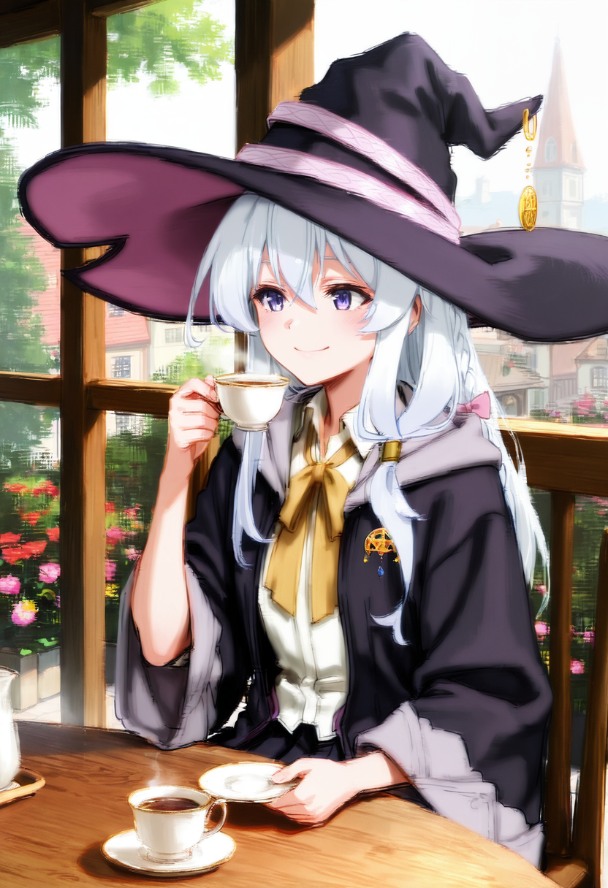

# Elaina (Wandering Witch: The Journey of Elaina) - Illustrious

Workflow: `elaina_illustrious.json` (drag into ComfyUI). Base: **WAI-illustrious-SDXL v17.0**. Elaina sitting at a cafe terrace. Keep prompts wholesome and SFW.

## Files needed

| File | What | Download | Put it in |
|---|---|---|---|
| `waiIllustriousSDXL_v170.safetensors` | Checkpoint (WAI-illustrious-SDXL v17.0, VAE included) by **WAI0731** | https://civitai.com/models/827184?modelVersionId=2883731 | `ComfyUI/models/checkpoints/` |
| `elaina_illustrious_v1.0.safetensors` | LoRA: Elaina \| Wandering Witch: The Journey of Elaina v1.0 by **Renco12** (downloads as `elaina_v1.0.safetensors`, rename it) | https://civitai.com/models/1574405 | `ComfyUI/models/loras/elaina/` |

If you put files elsewhere, re-pick them in the loader nodes.

## Trigger words

- Trigger: `aaelaina`
- Outfits: `elainawitch` (witch robe and hat), `elainacasual` (add `long sleeves` or `sleeveless`), `elainasleep` (sleepwear)

The yellow Note node in the workflow lists these plus tips. Keep `modest proportions` in the positive and `exaggerated proportions, explicit, genitals` in the negative.

## Settings

- Sampler dpmpp_2m, scheduler karras, 28 steps, CFG 5.5, 832x1216
- Hi-res fix: 1.5x latent upscale (bislerp), 20 steps, denoise 0.4, tiled VAE decode, final 1248x1824
- LoRA weight 0.9 (model and clip)
- Seed: random (both samplers set to randomize). Sample image seed: 1849171245

## License note

- **Renco12** LoRA: commercial use and selling generated images allowed.
- Elaina and Wandering Witch belong to their original creators (Jougi Shiraishi / C2C). This is a fan LoRA.

## Credits

- **WAI0731**: https://civitai.com/models/827184?modelVersionId=2883731
- **Renco12**: https://civitai.com/models/1574405

Questions or issues? Ask me on X: https://x.com/Antilitist
