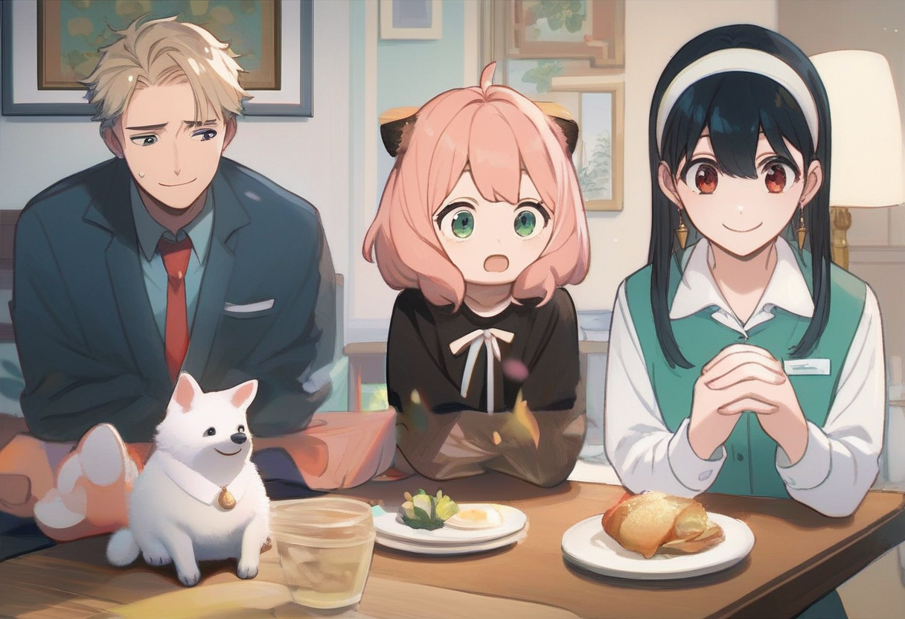

# Forger family dinner (regional) – Pony

Workflow: `forger_dinner_pony.json`. Base: **Pony**. Strictly wholesome and family-friendly (Anya is a child): `rating_safe`, fully clothed, strong negatives.

## Files needed

| File | What | Download | Put it in |
|---|---|---|---|
| `ponyDiffusionV6XL_v6StartWithThisOne.safetensors` | Checkpoint: Pony Diffusion V6 XL by **PurpleSmartAI** | https://civitai.com/models/257749?modelVersionId=290640 | `ComfyUI/models/checkpoints/pony/` |
| `Anya_Forger_-_Spy_X_Family.safetensors` | LoRA: Anya Forger (Pony V1) by **ethensia** | https://civitai.com/models/919274?modelVersionId=1028945 | `ComfyUI/models/loras/spyxfamily/` |
| `Loid_Forger-75.safetensors` | LoRA: Loid Forger / Twilight (Pony v1.0) by **duongve13112002** | https://civitai.com/models/1296565?modelVersionId=1463314 | `ComfyUI/models/loras/spyxfamily/` |
| `SpyxFamilyYorXL-v1-07.safetensors` | LoRA: Yor Forger (Pony v1.0) by **turkey910** | https://civitai.com/models/159553?modelVersionId=477954 | `ComfyUI/models/loras/spyxfamily/` |

## Regional prompting (no custom nodes needed)

This workflow uses ComfyUI's **built-in** hook-LoRA and area nodes (core ComfyUI, https://github.com/comfyanonymous/ComfyUI):
`CreateHookLora` → `SetClipHooks` → `CLIPTextEncode` → `ConditioningSetAreaPercentage` per character, merged with `ConditioningCombine` on top of a whole-scene prompt. Each character's LoRA only affects its own region's prompt.

Install: update ComfyUI to a recent version (hook nodes were added in late 2024): run `update/update_comfyui.bat` (portable build) or `git pull` in your ComfyUI folder, then restart. Nothing else to install.

The JSON is in ComfyUI **API format**: drag it onto the canvas (or use Workflow → Open) and ComfyUI lays out the nodes for you. Set the KSampler seed to random.

## Regions and LoRA weights

Loid left (x 0–36%) LoRA 0.7; Anya middle (x 34–66%) LoRA 0.75; Yor right (x 64–100%) LoRA 0.65; burnt-food region in table center (no LoRA, strength 0.9); Bond region bottom-left (no LoRA): `white fluffy dog, great pyrenees`.

## Trigger words

Anya: `anya forger, ahoge, meme` (+ `eden academy school uniform, gold trim, red ribbon` / `black dress`). Loid: `twilight` (+ `blonde hair, short hair, suit, red necktie`). Yor: `ChopioYor, black hair, red eyes, gold earrings` (+ modest outfit `outfit_1, office lady, collared shirt, white shirt, green vest, long sleeves`). Bond: no LoRA, `white fluffy dog, great pyrenees`.

## Settings

- Sampler euler_ancestral, scheduler normal, 28 steps, CFG 7, 1216x832, seed random

## Credits

- **PurpleSmartAI**: https://civitai.com/models/257749?modelVersionId=290640
- **ethensia**: https://civitai.com/models/919274?modelVersionId=1028945
- **duongve13112002**: https://civitai.com/models/1296565?modelVersionId=1463314
- **turkey910**: https://civitai.com/models/159553?modelVersionId=477954

Questions or issues? Ask me on X: https://x.com/Antilitist
