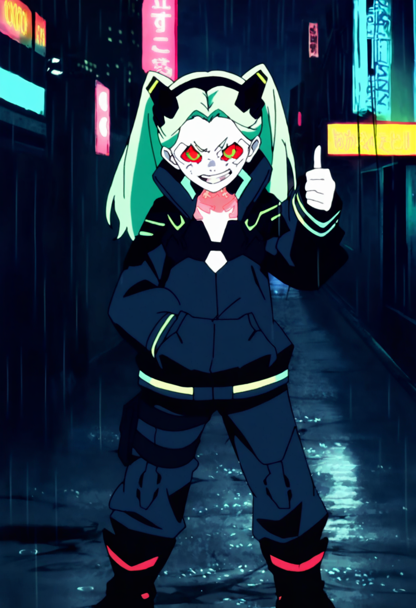

# Rebecca (Cyberpunk: Edgerunners) - Illustrious

Workflow: `rebecca_illustrious.json` (drag into ComfyUI). Base: **Illustrious-XL v2.0**. Rebecca in her black jacket, fully covered, on a rainy neon Night City street with a thumbs up. Keep prompts wholesome and SFW.

## Files needed

| File | What | Download | Put it in |
|---|---|---|---|
| `Illustrious-XL-v2.0.safetensors` | Checkpoint (Illustrious-XL v2.0, includes CLIP + VAE) by **OnomaAI Research** (Hugging Face) | https://huggingface.co/OnomaAIResearch/Illustrious-XL-v2.0/resolve/main/Illustrious-XL-v2.0.safetensors | `ComfyUI/models/checkpoints/illustrious/` |
| `rebecca_bloodredkittie_ILL_v1.1.safetensors` | LoRA (default): Rebecca from Cyberpunk: Edgerunners [IllustriousXL] v1.1 by **BloodRedKittie** (downloads as `ERRebecca.safetensors`, rename it) | https://civitai.com/models/1154121?modelVersionId=2520412 | `ComfyUI/models/loras/cyberpunk/` |
| `rebecca_vaporvvave_ILL_v1.safetensors` | LoRA (alternative, optional): Rebecca \|\| Cyberpunk: Edgerunners ILv1.0 by **Vaporvvave** (downloads as `Rebecca-60.safetensors`, rename it) | https://civitai.com/models/189419?modelVersionId=1375042 | `ComfyUI/models/loras/cyberpunk/` |

The workflow expects the subfolders shown above (for example `illustrious\...` or `cyberpunk\...`). If you put files elsewhere, re-pick them in the loader nodes.

## Trigger words

- BloodRedKittie LoRA (default, weight 0.8): `ERRebecca, green hair, pale skin, twintails`
- Vaporvvave LoRA (weight 0.7): `rebecca, green hair, twintails, yellow eye, mechanical eye, red sclera, black hairband, headgear, neck tattoo, black jacket, long sleeves`

The yellow Note node in the workflow explains how to swap from one LoRA to the other.

Keep `modest proportions, fully clothed` in the positive and `exaggerated proportions, nsfw, cleavage, revealing clothing, midriff` in the negative. Her design has very pale skin, so gaps in the outfit show up easily. Words that kept her covered: `fully zipped over a dark high-neck top, high-waisted long black cargo pants, boots, fully covered, no exposed skin on legs`, plus `bare legs, bare thighs, exposed thighs, thigh gap, hotpants, shorts` in the negative.

## Settings

- Sampler euler_ancestral, scheduler normal, 42 steps, CFG 6, 832x1216
- Then 1.5x lanczos upscale + fix pass: 24 steps, CFG 6, denoise 0.3 (tiled VAE encode/decode), final 1248x1824
- LoRA weight: BloodRedKittie 0.8 (model and clip); Vaporvvave 0.7
- Seed: random (both samplers set to randomize). Sample image seeds: base 81248814109101, fix pass 33646679817652

## License note

- **BloodRedKittie** LoRA: credit required, **no selling of generated images**, no derivatives/merges. Fine for personal and non-commercial posts.
- **Vaporvvave** LoRA: credit required, selling generated images allowed. Use this one for anything you sell.
- Rebecca and Cyberpunk: Edgerunners belong to CD PROJEKT RED / Studio Trigger. These are fan LoRAs.

## Credits

- **OnomaAI Research** (Hugging Face): https://huggingface.co/OnomaAIResearch/Illustrious-XL-v2.0
- **BloodRedKittie**: https://civitai.com/models/1154121?modelVersionId=2520412
- **Vaporvvave**: https://civitai.com/models/189419?modelVersionId=1375042

Questions or issues? Ask me on X: https://x.com/Antilitist
