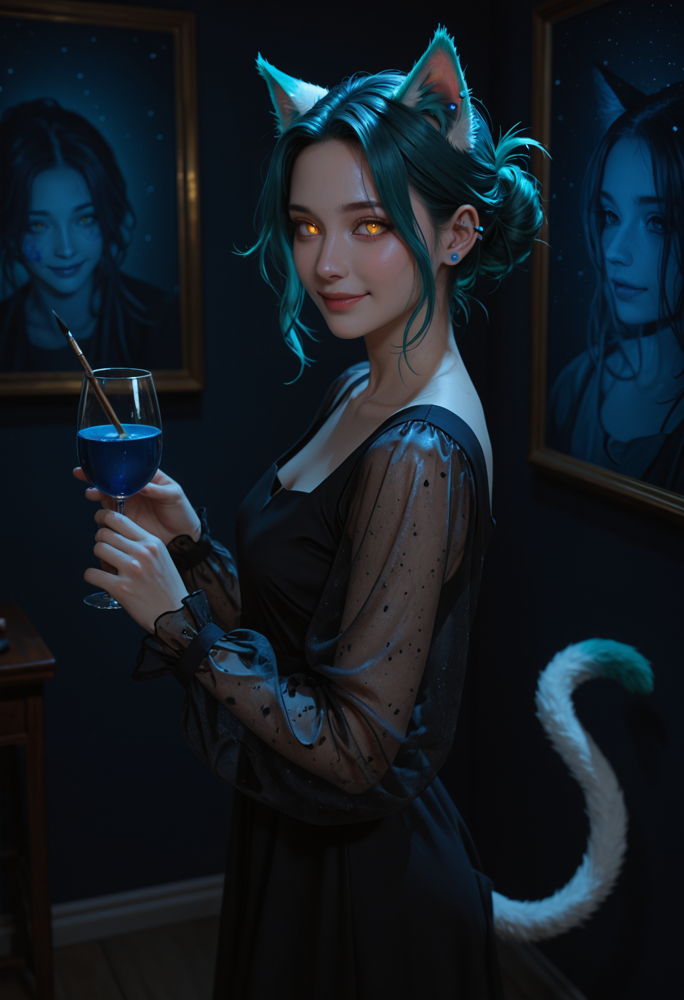

# Semi-real 2.5D (Illustrious) - low key lighting + hi-res fix + FaceDetailer

Workflow: `semireal_illustrious.json` (drag into ComfyUI). API version: `semireal_illustrious_api.json`. Base: **Semi-Real Illustrious MM v4.0**. Semi-realistic 2.5D look (anime-style face, realistic skin and hair) with a darkness slider LoRA for moody, low key light. The sample prompt is a generic cat girl in a black dress at a night-time art gallery. Keep prompts wholesome and SFW.

## Files needed

| File | What | Download | Put it in |
|---|---|---|---|
| `semiRealIllustrious_v40.safetensors` | Checkpoint: Semi-Real Illustrious MM v4.0 | https://civitai.com/models/1945811 | `ComfyUI/models/checkpoints/` |
| `lightingSlider_illustrious.safetensors` | LoRA: Lighting / darkness slider (Illustrious version). Downloads as `lightingSlider.safetensors`, rename it | https://civitai.com/models/1280702?modelVersionId=1444863 | `ComfyUI/models/loras/lighting/` |
| `face_yolov8m.pt` | Face detector for FaceDetailer | Impact Pack / Ultralytics model download (ComfyUI Manager > Model Manager) | `ComfyUI/models/ultralytics/bbox/` |

Custom nodes: **ComfyUI-Impact-Pack** and **ComfyUI-Impact-Subpack** (for FaceDetailer and UltralyticsDetectorProvider). Install them with ComfyUI Manager.

If you put files elsewhere, re-pick them in the loader nodes.

## Trigger words

None. The lighting LoRA is a slider: **negative weight = darker**, positive = brighter. The workflow uses **-0.8** (model and clip). The LoRA author suggests -0.5 to -1 together with a dark keyword in the prompt (`dark`, `late night`, `dimly lit`, `blue hour`). For a normal, bright look, bypass the LoRA node (select it, Ctrl+B) or set both weights to 0.

Dark scenes can drift toward cold blue light and blue eyes. Name the eye color, and add `warm spotlight, amber light` to the positive and `blue tint, blue lighting` to the negative if you want warm light. Keep `modest proportions, fully clothed` in the positive and `nsfw, cleavage, revealing clothing, flat lighting, even lighting` in the negative.

## Settings

- Base: 832x1216, sampler dpmpp_2m, scheduler karras, CFG 5, 30 steps
- Hi-res fix: 1.5x lanczos upscale, tiled VAE encode, 20 steps dpmpp_2m karras, CFG 5, denoise 0.4, tiled VAE decode. Final 1248x1824
- FaceDetailer: face_yolov8m, guide size 512, max 1024, 20 steps, CFG 5, denoise 0.35, tiled encode/decode
- LoRA: lighting slider -0.8 / -0.8
- Seed: random (all samplers set to randomize)

## License note

- **Lighting / darkness slider**: no credit required, derivatives allowed, generated images may be used commercially. Do not resell the model.
- **Semi-Real Illustrious MM v4.0**: credit required (see Credits), generated images may be used commercially, derivatives allowed.

## Credits

- Semi-Real Illustrious MM v4.0: https://civitai.com/models/1945811
- Lighting / darkness slider: https://civitai.com/models/1280702

Questions or issues? Ask me on X: https://x.com/Antilitist
